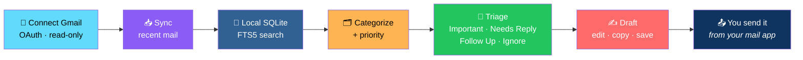
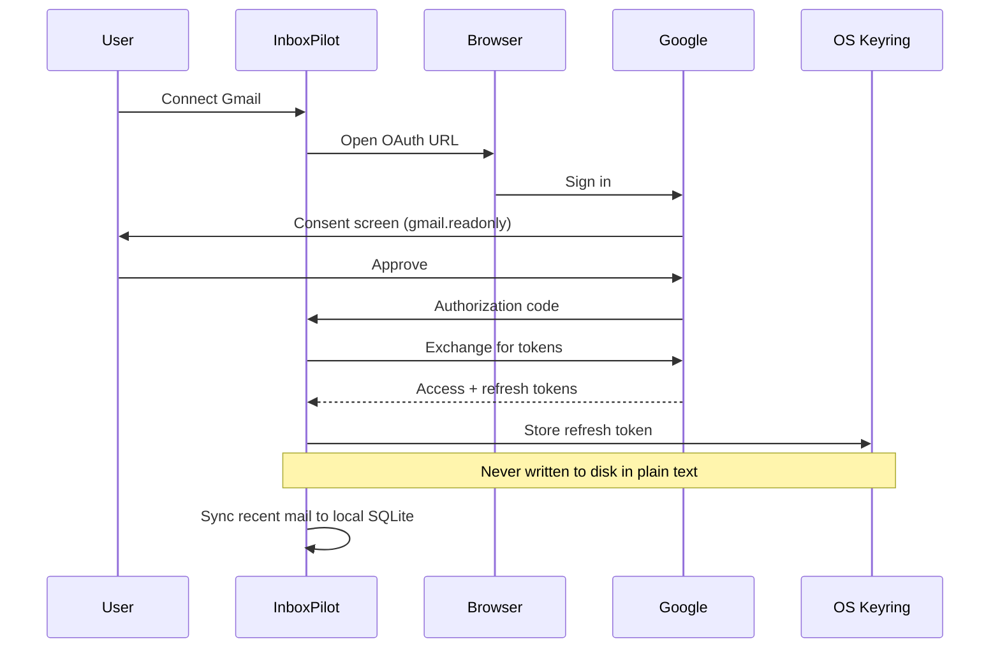
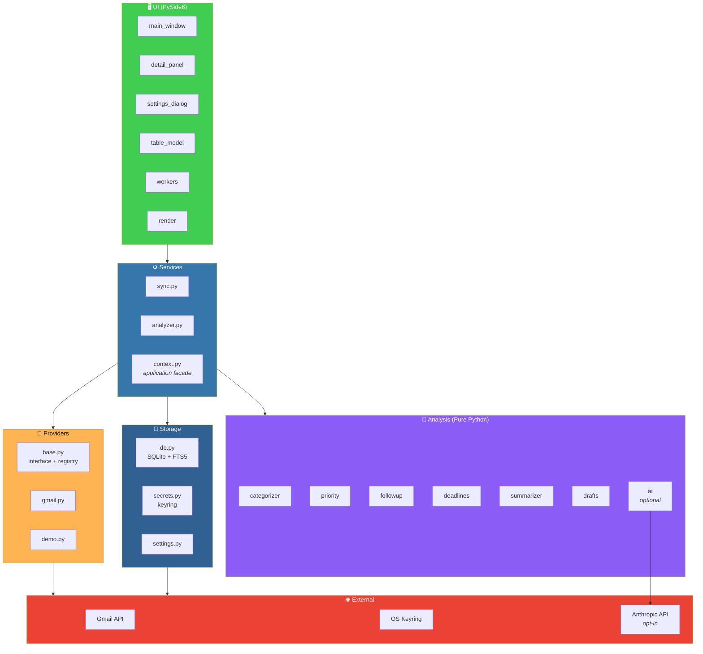

# 📧 InboxPilot

<div align="center">


**A desktop email command center.**

*See what's important, what needs a reply, what you're waiting on, and what you can ignore.*

[✨ Features](#-features) • [🚀 Quick Start](#-quick-start-development) • [🔗 Connecting Gmail](#-connecting-gmail) • [🔒 Privacy](#-privacy--security-model) • [🏗️ Architecture](#️-architecture)

</div>

---

## 📖 Overview

**InboxPilot** is a **desktop email command center**.

It connects to your mailbox through the provider's **official API and OAuth**, downloads recent mail into a **local SQLite database**, and helps you see:

- ⭐ **What is important**
- 💬 **What needs a reply**
- ⏳ **What you are waiting on**
- 🗑️ **What you can ignore** — newsletters, receipts, notifications

### 🔒 Core Promise

> **It is READ-ONLY.**
>
> **InboxPilot never sends, deletes, archives, labels, or edits email.**
>
> **Drafts are text you can edit, copy, or save *on your computer*** — **you send them yourself from your normal mail app.**

### The Workflow



---

## ✨ Features

<div align="center">

| 📊 Dashboard | 📋 Email List |
|:---:|:---:|
| **Folders:** Inbox · Important · Needs Reply · Follow Up · Newsletters · Receipts · Unread. **Stat cards:** unread · important · pending replies · received in last 7 days | Sender · subject · date · category · priority · unread marker. **Full-text search** *(SQLite FTS5)* · sender filter · category/priority filters · **date ranges** *(today / 7 / 30 days / custom)* · **sort by** date, sender, subject, priority, category, or unread |
| **📝 Summaries** | **🗂️ Categories** |
| Summary · Key Points · Action Items · Deadline · People Mentioned · Suggested Response. **Built only from sentences in the email** — **if no deadline is written, it says "No deadline identified."** | Work · Personal · Finance · Shopping · Newsletter · Social · Travel · Notifications — **plus manual Important / Needs Reply**. **Each suggestion shows *why*** — and **you can change any category** |
| **⭐ Priority** | **⏳ Follow-Up Detection** |
| High / Medium / Low **with the reasons** *(✓ directly addressed, ✓ contains a requested action, ✓ mentions a deadline, • bulk mail …)*. **You can override it** — **and reset to automatic** | **Needs Reply:** a question or request addressed to you, **not already answered in the thread**, **with the quoted evidence**. **Follow Up:** mail *you* sent that asked something and got no reply after **N days** *(default 3)*, plus anything you flag manually |
| **✍️ Draft Assistant** | **🔒 Privacy** |
| Generates an editable reply with `[placeholders]` for anything only you can know. **Buttons:** Edit · Copy · Save Draft. **Never sent automatically** | **OAuth only** · refresh token in the **OS credential store** · **Connect / Disconnect** *(optionally deleting all local data)* |
| **🤖 Optional AI** | |
| **Off by default.** Anthropic API for summaries/drafts on one selected email — **only when you click**. **Output is validated** *(e.g. an invented deadline is discarded)*. **Falls back to local analysis on any failure** | |

</div>

### 📝 What "Built Only From the Email" Means

| Section | Source |
|---------|--------|
| **Summary** | Sentences in the email |
| **Key Points** | Sentences in the email |
| **Action Items** | Sentences in the email |
| **Deadline** | **Literal phrase in the email** — or "No deadline identified." |
| **People Mentioned** | Names in the email |
| **Suggested Response** | Template with placeholders |

---

## 🚀 Quick Start *(Development)*

```bash
python -m venv .venv
.venv\Scripts\activate          # Windows
# source .venv/bin/activate     # macOS/Linux

pip install -r requirements.txt
python run_inboxpilot.py
```

> ✅ **Click "Explore with a demo mailbox"** to try everything **without connecting an account** — **all data is fictional**.

---

## 🔗 Connecting Gmail

> **Gmail's API requires an OAuth client that belongs to a Google Cloud project.**

### One-Time Setup

1. Go to **[console.cloud.google.com](https://console.cloud.google.com/)**, create a project, and **enable the Gmail API**
2. **APIs & Services → OAuth consent screen** — choose *External*, add your own address under **Test users**
3. **Credentials → Create credentials → OAuth client ID → Application type: Desktop app** — **download the JSON**
4. In InboxPilot: **Settings → Gmail OAuth client file → Browse…** and pick that JSON
   - *Or* save it as `client_secret.json` in the InboxPilot data folder
   - *Or* next to `InboxPilot.exe`
   - *Or* set `INBOXPILOT_GMAIL_CLIENT_SECRETS`
5. **Connect Gmail** — your browser opens Google's own sign-in page; approve the single permission *"View your email messages and settings"* (`gmail.readonly`)

### 📝 Important Notes

<div align="center">

| Note | Details |
|------|---------|
| **Testing mode** | While the app is in Google's *Testing* mode, **refresh tokens expire after 7 days** — you'll simply reconnect |
| **Restricted scope** | `gmail.readonly` is a Google **restricted scope**. **Personal use with your own project is fine.** Distributing the app to others requires your own OAuth client **plus Google's app verification** *(and, for restricted scopes, a security assessment)* |
| **Policy, not workaround** | **That's a Google policy requirement, not something the app can work around** |

</div>

---

## 🔒 Privacy & Security Model

> **This is the most important part of InboxPilot.**

<div align="center">

| Guarantee | Implementation |
|-----------|---------------|
| **🚫 No passwords** | **There is no IMAP/SMTP code** — sign-in happens **in your browser on the provider's page** |
| **🔐 Read-only token** | The only Gmail scope requested is **`gmail.readonly`** — **the token cannot modify mail even if the app were buggy**. **Tests assert** that the Gmail provider only calls `messages.list`, `messages.get`, and `getProfile` |
| **🔑 Secure token storage** | Only the OAuth **refresh token** is stored, via **`keyring`** → Windows Credential Manager / macOS Keychain / Secret Service. **If no secure backend exists**, the token is kept **in memory for the session only** — **never written to disk in plain text** |
| **🔌 Clean disconnect** | *Account → Disconnect* **deletes the stored token**, **asks Google to revoke it**, and *(checkbox, on by default)* **deletes all downloaded mail, summaries, and drafts** |
| **💾 Local cache** | Message text is stored in **`inboxpilot.db`** *(`%APPDATA%\InboxPilot` on Windows)*. **InboxPilot does NOT encrypt this file** — use full-disk encryption such as BitLocker. **Logs contain IDs, counts, and error text only** |
| **🤖 AI is opt-in** | **Nothing leaves your computer** except Google API traffic — **unless you enable AI in Settings AND click *Summarize with AI* / tick *Use AI* for a draft**. Then the text of **that one email** is sent to the Anthropic API. **The model is instructed to use only the email's content and to treat it as data, not instructions** |
| **👀 Reading ≠ marking read** | **Opening a message in InboxPilot does not change its read state in your mailbox** |

</div>

### 🔐 The Auth Flow



---

## 🧠 How the Analysis Works *(and Its Limits)*

> **Analysis is deterministic rules, not a black box.**
>
> **That makes it explainable — but it will sometimes be wrong.** **Which is why every label has a reason and every label can be overridden.**
>
> **Overrides are stored separately from automatic values** — **so re-syncing never undoes your choices.**

### 🎯 The Rules

<div align="center">

| Rule | Detail |
|------|--------|
| **Needs Reply** | Skips newsletters, automated senders, mail where you are only CC'd, and threads where **you already replied** |
| **Deadlines** | Only reported if a phrase like **"by Friday 5pm"** or **"due March 14"** is **literally in the message**. **Relative phrases are interpreted relative to the date the email was sent** and **labelled as such**; **ambiguous dates like `10/12` are not guessed** |
| **Receipts** | Include invoices and order confirmations |
| **Local summaries** | **Extractive** — they quote sentences from the email, so they can read a little choppy |
| **AI summaries** | **Smoother prose** — but **should still be checked against the original** |

</div>

### 🏗️ The Analysis Pipeline

```mermaid
flowchart LR
    Email["📧 Email"] --> Cat["🗂️ Categorizer"]
    Cat --> Pri["⭐ Priority<br/>+ reasons"]
    Pri --> Follow["⏳ Follow-up<br/>Needs Reply · Follow Up"]
    Follow --> Summ["📝 Summarizer<br/>extractive"]
    Summ --> Draft["✍️ Draft generator"]
    Draft --> Override["✏️ User Override<br/><em>stored separately</em>"]
    Override --> UI["🖥️ Dashboard"]

    style Email fill:#61DAFB,color:#000
    style Cat fill:#8B5CF6,color:#fff
    style Pri fill:#FFB454,color:#000
    style Follow fill:#22C55E,color:#fff
    style Summ fill:#0EA5E9,color:#fff
    style Draft fill:#FF6B6B,color:#fff
    style Override fill:#FFD700,color:#000
    style UI fill:#0f3460,color:#fff
```



---

## 🏗️ Architecture

### System Overview



### 📂 Project Layout

```
inboxpilot/
├── src/inboxpilot/
│   ├── analysis/     categorizer · priority · followup
│   │                 deadlines · summarizer · drafts · ai
│   │                 <em>pure Python · no Qt</em>
│   │
│   ├── providers/    base.py (interface + registry)
│   │                 gmail.py · demo.py
│   │
│   ├── storage/      db.py (SQLite + FTS5)
│   │                 secrets.py (keyring)
│   │                 settings.py
│   │
│   ├── services/     sync.py · analyzer.py
│   │                 context.py (application facade)
│   │
│   └── ui/           PySide6: main_window · detail_panel
│                     settings_dialog · table_model
│                     workers · render
│
├── tests/            unittest/pytest-compatible suite
│
└── packaging/        PyInstaller spec
                      PowerShell build script
                      Inno Setup installer script
```

### Design Principles

<div align="center">

| Principle | Implementation |
|-----------|---------------|
| **🔒 Read-only by design** | The only Gmail scope is `gmail.readonly` — **the token cannot modify mail, even if the app were buggy** |
| **🧠 Analysis is pure Python** | `analysis/` has **no Qt** — everything is testable without a display |
| **🔌 Providers are swappable** | `EmailProvider` is the interface — Gmail and Demo are implementations |
| **✏️ Overrides are separate** | User choices are stored **separately from automatic values** — **re-syncing never undoes them** |
| **🔐 Secrets stay in the OS keyring** | If no keyring is available, tokens are **memory-only** — **never written to disk in plain text** |
| **🤖 AI is opt-in** | **Off by default** — and **only the selected email's text** is sent, **with validation of the output** |
| **🔍 Evidence with every label** | **Every priority and category suggestion shows why** |
| **📤 You send drafts yourself** | InboxPilot never sends mail |
| **🚫 No fake features** | Every limitation is documented |

</div>

### 🔌 Adding Another Email Provider *(e.g. Microsoft Graph)*

**Create `providers/outlook.py`:**

1. **Subclass `EmailProvider`**
2. **Implement:**
   - `create`
   - `account_email`
   - `connect` *(OAuth)*
   - `disconnect`
   - `is_connected`
   - `list_ids(scope, since)`
   - `fetch_messages(ids)` — returning `EmailMessage` objects
3. **Decorate the class with `@register`**
4. **Import it in `providers/__init__.py`**

> ✅ **Use a read-only scope** *(`Mail.Read`)*.
>
> **Sync, analysis, storage, and UI need NO changes** — *(just add a menu entry that calls `ctx.connect("outlook")`)*.

---

## 🧪 Tests

```bash
python -m unittest discover -s tests      # no extra packages needed
# or:  pip install pytest && pytest
```

### What the 72 Tests Cover

<div align="center">

| Area | Coverage |
|------|:--------:|
| **Deadline extraction** | ✅ |
| **Categorisation** | ✅ |
| **Priority explanations** | ✅ |
| **Follow-up detection** | ✅ |
| **Summaries** | ✅ |
| **Drafts** | ✅ |
| **SQLite search / filter / sort / date ranges** — including FTS special characters and the LIKE fallback | ✅ |
| **Sync against the demo provider** — read-state mirroring · pruning · **overrides surviving re-sync** | ✅ |
| **Gmail message parsing** | ✅ |
| **The read-only / no-password guarantees** | ✅ |
| **Token storage** | ✅ |
| **AI parsing with a fake client** — including **rejecting invented deadlines** | ✅ |
| **Qt smoke test** — runs automatically when PySide6 is installed *(`QT_QPA_PLATFORM=offscreen`)* | ✅ |

</div>

---

## 📦 Windows Packaging

```powershell
powershell -ExecutionPolicy Bypass -File packaging\build_windows.ps1
```

### What It Does

1. **Creates a virtualenv**
2. **Installs dependencies**
3. **Runs the tests**
4. **Builds `dist\InboxPilot\InboxPilot.exe`** with PyInstaller
5. **If [Inno Setup](https://jrsoftware.org/isinfo.php) is installed** — **builds `dist\InboxPilot-Setup.exe`**

> 💡 **Place your OAuth `client_secret.json` next to `InboxPilot.exe`** if you want it to work without the Settings step.

---

## 🔧 Troubleshooting

<div align="center">

| Problem | Fix |
|---------|-----|
| **"Gmail needs a Google OAuth client file"** | Follow [Connecting Gmail](#-connecting-gmail) — then pick the JSON in **Settings** |
| **"Access blocked / app not verified"** | Add your address as a **Test user** on the OAuth consent screen |
| **"Gmail API has not been used in project…"** | **Enable the Gmail API** in your Google Cloud project |
| **Asked to sign in again after a week** | **Normal in Google's Testing mode** *(7-day refresh-token expiry)* |
| **"No secure credential store"** in Settings | Install/enable a keyring backend *(Linux: GNOME Keyring or KWallet)* |
| **Anything else** | *Help → Open log file* |

</div>

---

## 🗺️ Roadmap

### ✅ Current

- [x] Read-only Gmail integration via official API and OAuth
- [x] Demo mailbox for exploring without an account
- [x] Local SQLite database with FTS5 full-text search
- [x] Dashboard with Inbox, Important, Needs Reply, Follow Up, Newsletters, Receipts, and Unread folders
- [x] Stat cards for unread, important, pending replies, and 7-day received
- [x] Email list with search, sender filter, category and priority filters, date ranges, and multi-field sort
- [x] Extractive summaries with Summary, Key Points, Action Items, Deadline, People Mentioned, and Suggested Response
- [x] Literal deadline extraction — or "No deadline identified."
- [x] 8 auto-detected categories plus manual Important / Needs Reply
- [x] Every category and priority suggestion shows its reason
- [x] Priority overrides with reset-to-automatic
- [x] Needs Reply detection with quoted evidence
- [x] Follow Up detection with configurable N-day default and manual flagging
- [x] Draft assistant with `[placeholders]`, Edit / Copy / Save Draft
- [x] Never sends email automatically
- [x] Optional AI off by default with per-email consent and validated output
- [x] Automatic fallback to local analysis on AI failure
- [x] OAuth only — no passwords, no IMAP/SMTP
- [x] Only `gmail.readonly` scope requested
- [x] Token stored in the OS credential store
- [x] Memory-only token fallback when no keyring is available
- [x] Disconnect revokes at Google and optionally wipes local data
- [x] Reading a message never marks it read in the mailbox
- [x] Deterministic rules-based analysis — no black box
- [x] User overrides stored separately and survive re-sync
- [x] 72-test suite covering extraction, categorisation, priority, follow-up, summaries, drafts, storage, sync, parsing, security guarantees, token storage, AI validation, and a Qt smoke test
- [x] PySide6 native UI with background workers
- [x] PyInstaller packaging with Inno Setup support
- [x] Provider abstraction with documented Microsoft Graph extension path
- [x] Windows, macOS, and Linux support via keyring

### 🔜 Future Ideas

- [ ] **Microsoft Outlook provider** — Microsoft Graph with `Mail.Read`
- [ ] **Additional providers** — Fastmail, ProtonMail *(where APIs exist)*
- [ ] **Message body encryption** — beyond relying on OS full-disk encryption
- [ ] **Configurable analysis rules** — let power users tune the heuristics
- [ ] **Saved searches** — reusable filter presets
- [ ] **Thread view** — conversation-level navigation
- [ ] **Notification center** — surface Needs Reply in the background
- [ ] **Bulk actions** — would require scope expansion; deliberately not planned
- [ ] **Streaming AI responses** — token-by-token instead of one round trip
- [ ] **Localization** — bilingual UI

---

## 🤝 Contributing

Contributions are welcome. Please:

1. Fork the repository
2. **Keep it read-only** — never request a write scope
3. **Keep analysis deterministic and traceable** — every label needs a listed reason
4. **Keep `analysis/` free of Qt** — it must stay testable without a display
5. **Store overrides separately** — re-syncing must never undo them
6. **Never write tokens to disk in plain text**
7. **Never send email automatically** — drafts are yours to send
8. **Keep AI opt-in and validated** — reject invented content
9. **Add tests for any new analysis rule or provider**
10. Submit a Pull Request

### Guidelines

- **Never request your password** — OAuth only, always
- **Never expand the scope** beyond `gmail.readonly` for the Gmail provider
- **Never log email contents** — IDs, counts, and error text only
- **Never bypass the keyring fallback** — memory-only is the safe default
- **Never auto-send a draft**
- **Never fabricate content** — empty sections must say so

---

## 📜 License

MIT — see [LICENSE](LICENSE) for details.

---

## 🙏 Acknowledgments

- **Google** — for a Gmail API that respects read-only scopes
- **PySide6** — for a desktop UI that feels native
- **`keyring`** — for making secure token storage a solved problem
- **Every inbox that's ever made someone feel behind** — this one's for you

---

<div align="center">

### 📧 SYNC. TRIAGE. REPLY. DONE.

**A desktop email command center.**

**Read-only. Local. AI opt-in only.**

<br>

> 🔒 **InboxPilot cannot modify your mail — the token won't allow it.**

<br>

⭐ If InboxPilot helped you, consider giving it a star.

<br>

[⬆ Back to Top](#-inboxpilot)

</div>
